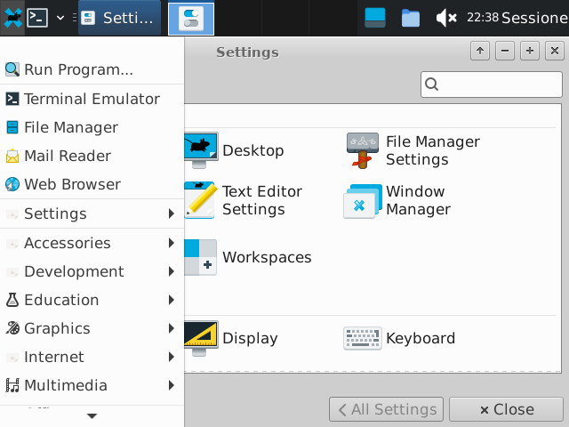
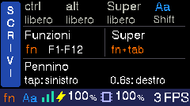
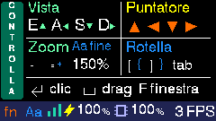
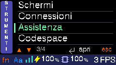
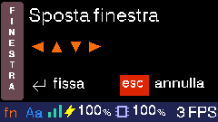
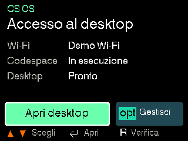
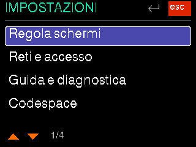
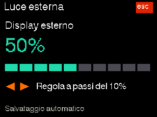

# Cardputer Code Space OS

CS OS uses a Cardputer ADV with an external touch TFT to control an XFCE Linux desktop hosted in GitHub Codespaces. The Cardputer's built-in display shows client controls, while the external TFT displays the remote desktop. CS OS works on the development setup and is still in active development. Audio can drop out during a session, and the video can slow down when the desktop is busy.

## Install CS OS

You need an M5Stack Cardputer ADV, a 2.8-inch TFT with XPT2046 touch, a USB data cable, and a GitHub account with access to Codespaces.

1. Connect the display and touch controller using the [V2 wiring diagram](docs/CABLAGGIO-V2.md).
2. [Create and configure the Codespace](docs/SETUP.md#codespaces-host). It runs XFCE and the server that the Cardputer connects to.
3. On your computer, [build the firmware with your settings](docs/SETUP.md#cardputer-adv-client) and [flash the Cardputer](docs/SETUP.md#flashing-the-cardputer).

## Use the desktop

Connect the Cardputer to Wi-Fi. When the connection screen is ready, select **Apri desktop** (Open desktop) and press **Enter**. Linux appears on the external TFT. The Cardputer's own display shows the active controls.

| What you want to do | How |
| --- | --- |
| Type in Linux | Tap **Opt** until the small screen shows **Scrivi** (Type). |
| Move the pointer or drag | Tap **Opt** for **Controlla** (Control). Use the triangle keys to move the pointer, **Enter** to click, and **Space** to start or release a drag. |
| Use the touchscreen | Tap the TFT to left-click. Hold the stylus still for at least 0.6 seconds to right-click. |
| Open settings or the on-device guide | Hold **Opt** for one second. For help, choose **Guida e diagnostica** → **Guida ai comandi**. |

The [user guide](docs/CONTROLLI.md) covers the first session, the XFCE panel, keyboard shortcuts, zoom, audio, and how to disconnect or stop the Codespace. The [optional desktop applications](docs/SETUP.md#optional-desktop-applications) include LibreOffice and tools for PDFs, images, media, and archives.

*XFCE on the development Codespace at 640 × 480.*

## On-device screens

These previews use the firmware's C++ renderers with simulated session data.

### Built-in HUD (240 × 135)

| Scrivi (typing) | Controlla (desktop controls) |
| --- | --- |
|  |  |

| Tools menu | Move window |
| --- | --- |
|  |  |

### External TFT (320 × 240)

| Desktop connection | Local settings | Backlight |
| --- | --- | --- |
|  |  |  |

## Verification status

CS OS was used on the development Codespace with the Cardputer ADV and V2 TFT. The firmware builds, and the desktop profile and server passed offline checks. The public bootstrap has yet to be tested end to end on a fresh Codespace.

## Contributing

I build and maintain CS OS on my own. On my setup I can use the Cardputer keyboard and touchscreen to control XFCE, and the picture sharpens again after I move a window. Audio still drops out, and the video slows down when the desktop is busy. Those two paths need the most optimization.

I'd welcome contributions that make audio more reliable, keep the desktop responsive under load, or make CS OS easier to set up on a fresh Codespace. The [contribution guide](CONTRIBUTING.md) has starting points for each area.

See the [architecture](docs/ARCHITETTURA.md), [system reference](docs/SYSTEM.md), [version notes and historical packages](docs/VERSIONI.md), and [third-party components](THIRD_PARTY.md).
