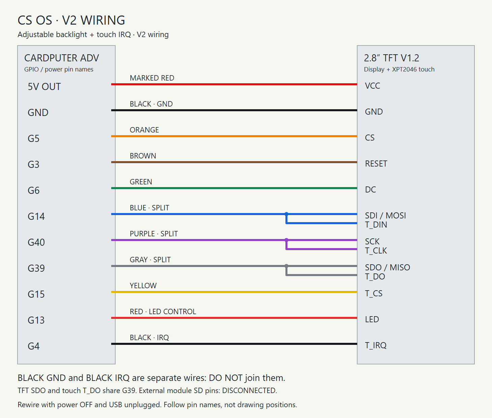

# Required wiring: V2 with adjustable backlight and touch IRQ

Power off the device and unplug USB before wiring.

**Status: V2 installed after rewiring. External brightness control confirmed by the operator; internal and external brightness stayed at 50% across two restarts. Full hardware testing and power measurements remain open.**

[Vector SVG diagram](images/cablaggio-v2.svg).
The accompanying drawing shows the logical connections. Use the device's pinout to identify the physical connector positions.

## All V2 connections

| Cardputer ADV | Wire color | TFT/touch pin |
| --- | --- | --- |
| 5V OUT | Marked red wire | VCC only |
| GND | Black, labeled GND | GND |
| G5 | Orange | CS |
| G3 | Brown | RESET |
| G6 | Green | DC |
| G14 | Split blue wire | SDI/MOSI and T_DIN |
| G40 | Split purple wire | SCK and T_CLK |
| G39 | Split gray wire | SDO/MISO and T_DO |
| G15 | Yellow | T_CS |
| G13 | Red | LED |
| G4 | Black, labeled IRQ | T_IRQ |

The two black wires are separate: **do not connect IRQ to GND**. Three signals are shared: blue G14 MOSI, purple G40 SCK, and gray G39 MISO (TFT SDO/MISO plus touch T_DO).

**Do not leave the LED pin tied to 5 V when it is connected to GPIO13.**
**TFT SDO is connected to G39**; it is not an unused pin. All SD pins on the external module are disconnected. This is the current V2 topology, confirmed directly by the operator in the November 9, 2026 diagram.

G4 and G13 denote GPIO numbers, *not* positions in the EXT connector.

## Electrical basis and limitations

A photo of the 2.8-inch SPI 240 × 320 V1.2 module shows Q1, R5, and R6 in its backlight circuit, consistent with the MSP2807 circuit: the LED pin is a logic control input driving a transistor through R6, not a GPIO that directly powers the LEDs. The reference diagram specifies active-high PWM. This is a documentation/photo correspondence, **not an electrical measurement of the particular unit**.

VCC remains at 5 V through the module's regulator; the J1 bypass jumper must remain open. Do not change that jumper to obtain brightness control.

Sources: [MSP2807 schematic](https://www.lcdwiki.com/res/MSP2807/MSP2807-2.8-SPI.pdf), [official Cardputer ADV pinout](https://docs.m5stack.com/en/core/Cardputer-Adv).

Actual power savings and electrical/functional compatibility of the physical module have not yet been fully tested. This is not a change to the ADV charging circuit.

## Installed firmware and controls

- The LED on G13 uses M5GFX's existing `Light_PWM`: 12 kHz, channel 5, separate from the built-in display backlight on channel 7. No new library.
- T_IRQ on G4 uses the XPT2046_Touchscreen library's built-in interrupt support: no SPI transfers inside the ISR and no new threshold or filter.
- Hold Opt → **Regola schermi** (Displays). Use **Luce interna** (HUD brightness), **Luce esterna** (TFT brightness), or **TFT: spegni** / **TFT: accendi**.
- Both brightness controls change in 10% steps. External brightness is stored separately in NVS (`csosdevice/settings`, a versioned record); when no value exists in an earlier profile it defaults to 100%. Temporary screen blanking is not saved.
- **TFT Off** is available during a Linux session. The HUD stays on so the TFT can be turned back on, touch is suspended, and the session/video continues. Adjusting External brightness also turns the TFT back on. After disconnecting, the pre-desktop view is visible again.
- When offline, external brightness can be adjusted, but temporary TFT blanking is unavailable so that the local TFT controls cannot be hidden.
- No new automatic mode, deep sleep, or changes to presence or Codespace startup. Blanking turns off the TFT backlight, **not** power, CPU, Wi-Fi, or video transfer.

## Physical checks after installation

1. External brightness 100 → 10 → 20%: the TFT changes; the HUD remains independent.
2. Internal brightness: the HUD changes; the TFT remains independent.
3. Stylus: tap, long press, and release near edges and inside menus.
4. During a session: use the HUD to turn the TFT off/on; touch is inactive while dark; disconnect with the TFT dark and confirm the pre-desktop becomes visible.
5. After restart: external brightness remains saved, while temporary blanking resets.

Host-side tests and firmware builds do not replace these physical checks or measure battery life.
