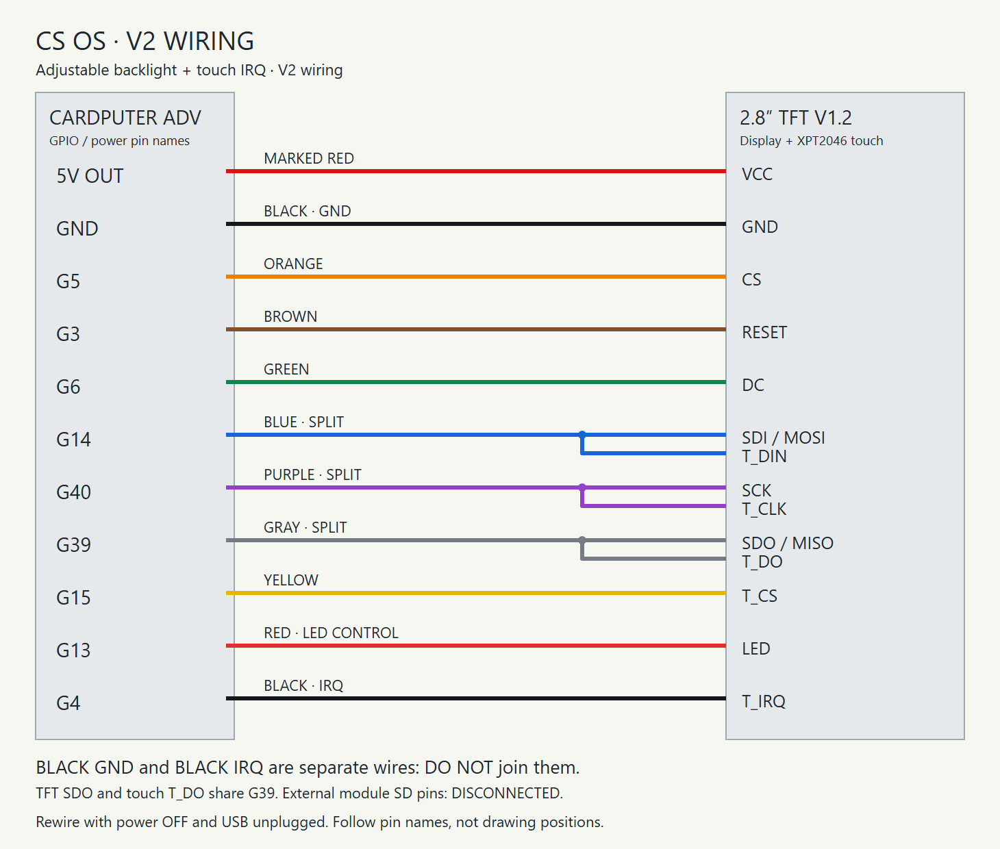

# Current hardware and wiring

This firmware requires **V2 wiring**. G13 controls the external TFT backlight and G4 carries the touch interrupt. The development device has used V2 since November 4, 2026.

Both backlight controls worked, and their 50% settings were retained across two restarts. Full hardware qualification and power consumption measurements remain open.

## Complete connections

| Cardputer ADV | Wire color | TFT/touch pin |
| --- | --- | --- |
| 5V OUT | Marked red wire | VCC only |
| GND | Black, labeled GND | GND |
| G5 | Orange | CS |
| G3 | Brown | RESET |
| G6 | Green | DC |
| G14 | Split blue wire | SDI/MOSI and T_DIN |
| G40 | Split purple wire | SCK and T_CLK |
| G39 | Split gray wire | SDO/MISO and T_DO |
| G15 | Yellow | T_CS |
| G13 | Red | LED |
| G4 | Black, labeled IRQ | T_IRQ |

The shared wires are **blue G14**, **purple G40**, and **gray G39**.
The **marked red 5V OUT wire goes to VCC only**; the LED pin uses the separate red G13 wire.
The two black wires are distinct: **GND and T_IRQ must not be connected together**.
**The TFT SDO/MISO and touch T_DO are both connected to G39.**
All microSD pins on the external display module are left disconnected.

Power off the device and unplug USB before wiring.

[Wiring details, SVG diagram, and test limitations](CABLAGGIO-V2.md).

The built-in touch calibration was measured for this particular display unit. Another module may need its own calibration.
